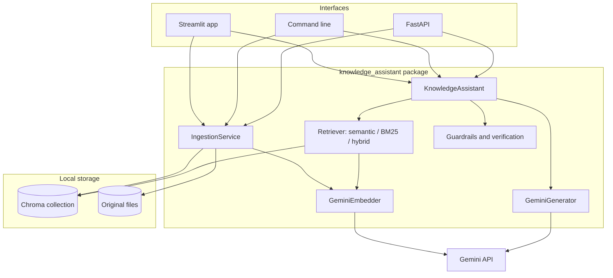

# Technical design

## 1. System architecture

The application is a single Python package used by three interfaces (Streamlit web app, command line, HTTP API). It has two pipelines that share a vector store.

## 2. Main components

| Component | Responsibility | Key decisions |
|---|---|---|
| Extraction | Validate files and extract text per page | PDFium for PDFs (correct word spacing in tables, page rendering); python-docx in document order; headers, footers and page numbers removed with conservative rules |
| Chunking | Sections, then chunks with overlap | A chunk never spans two sections, so each citation points to one section; page ranges tracked by character offsets |
| Embeddings | Vectors for passages and questions | Separate task types (`RETRIEVAL_DOCUMENT`, `RETRIEVAL_QUERY`); 768 dimensions normalised; document and section prepended to each passage |
| Vector store | Chroma collection with metadata | One collection per embedding model; document list derived from chunk metadata (single source of truth) |
| Version resolution | Current vs superseded documents | Declared status, or a newer version with the same document ID; superseded documents excluded at query time with a metadata filter |
| Retrieval | Top-k passages | Semantic by default; BM25 and hybrid (reciprocal rank fusion) for comparison |
| Prompt | Rules and evidence | Numbered excerpts with escaped text; untrusted-data rule; random canary |
| Generation | Structured answer | JSON schema with status, statements, support type, sources and note |
| Verification | Trust nothing from the model | Valid sources only, unsupported statements removed, numbers checked, canary leak blocked |
| Evaluation | Measure | Labels on sections, deterministic checks, failures listed |

## 3. Data flow

**Ingestion**: upload → signature and size checks → extraction per page → cleaning → metadata from the header block → sections → chunks (1,000 characters, 150 overlap) → injection flags → embeddings (batches of 50) → delete the previous version of the same file name → upsert in Chroma → store the original file.

**Question**: validation → query embedding (cached) → Chroma query filtered on current documents → top 5 passages → relevance floor (`MIN_RELEVANCE`) → prompt → Gemini JSON answer → verification → citations built from metadata → structured log (no content).

Every chunk carries: document key (SHA-256 prefix), file name and type, title, document ID, version, effective date, declared status, section, page range, chunk index and injection flag.

## 4. API boundaries

| Endpoint | Input | Output | Errors |
|---|---|---|---|
| `GET /health` | - | status, version | - |
| `GET /documents` | - | document list with statuses, passage count | - |
| `POST /documents` | multipart file (limit read before parsing) | ingestion result | 422 with error code for rejected files |
| `POST /ask` | question, `include_superseded` | status, statements, note, citations, retrieved passages, usage, latency, cost | 422 invalid question, 503 configuration or model unavailable, 502 invalid model response |

The API has no authentication in this version; it is meant to run behind a gateway that authenticates users.

## 5. Model and retrieval choices

- **Gemini instead of OpenAI** (the brief suggested OpenAI as a starting point): a free tier allows a public demo and a reproducible evaluation at no cost, the API supports a JSON response schema, and the embedding model is multilingual, which matters because employees ask in French about English documents. The provider is isolated behind two small interfaces (`AnswerGenerator`, `Embedder`).
- **`gemini-3.5-flash-lite`** for answers: the task is extraction and synthesis from 5 short passages, not open-ended reasoning, so a small fast model is the right first choice; the evaluation decides whether a larger model is needed. The default temperature is kept, as Google recommends for Gemini 3 models.
- **`gemini-embedding-001` at 768 dimensions**: a quarter of the storage of the full 3,072 dimensions, with little loss for short passages.
- **Chroma embedded**: no server to run, persistent on disk, metadata filters. Enough for a pilot; a managed vector database is the production option.
- **Top-k = 5, 1,000-character chunks with 150 overlap**: most sections of the corpus fit in one chunk (median passage: 316 characters), multi-document questions need 2 to 3 passages, and 5 passages keep the prompt short.

## 6. Alternatives considered

| Alternative | Decision |
|---|---|
| LangChain or LlamaIndex | Not used: the pipeline is short, and writing it directly makes every step testable and explainable |
| Fixed-size chunking | Replaced by section-aware chunking so that citations point to one section |
| Letting the model write citations (document names, pages) | Replaced by numbered excerpts mapped by code, so the model cannot invent a source |
| Free-text answers | Replaced by a JSON schema so that statements and sources can be verified |
| Hybrid search by default | Implemented and evaluated; the default follows the evaluation results |
| Reranking model | Deferred: measured need first |
| OCR | Out of scope for the MVP; scanned PDFs are rejected with a clear message |
| pypdf for PDF text | Replaced by PDFium after tests showed words glued together in table cells |

## 7. Cost and latency

- Indexing the 32 sample documents: 239 passages, about 103,000 characters (roughly 26,000 tokens) embedded in 5 batch calls; about $0.004 at paid-tier prices.
- Per question: one query embedding and one generation call. The system prompt is about 600 tokens and 5 passages (median 316 characters) add about 600 to 1,000 tokens. The evaluation report gives the measured average tokens, latency and cost.
- Latency is dominated by the generation call; retrieval in Chroma takes milliseconds at this scale.
- Questions that retrieve nothing (empty index or below the relevance floor) cost no generation call.

## 8. Risks and mitigations

| Risk | Mitigation | Residual risk |
|---|---|---|
| Hallucinated rule or number | Answer only from excerpts; statements without valid sources removed; numbers checked | Wrong reasoning with correct numbers |
| Invented or wrong citation | Model cites excerpt numbers only; mapping done by code | Model cites a passage that does not support the statement |
| Outdated procedure used | Version resolution and metadata filter | Documents without version metadata |
| Contradictory documents | Prompt rule to report both; evaluation category | Model picks one version silently |
| Prompt injection in documents | Escaping, untrusted labels, detection patterns, output checks, evaluation | New attack phrasings |
| Confidential data exposure | No content in logs; per-session uploads in the public demo | No access control yet (major blocker for real data) |
| Model API outage or rate limit | Retries with backoff, clear errors, abstention without model call when possible | Service unavailable during outages |
| Extraction errors (tables, scans) | PDFium, tests on real layouts, rejection of scans | Complex tables flattened |
